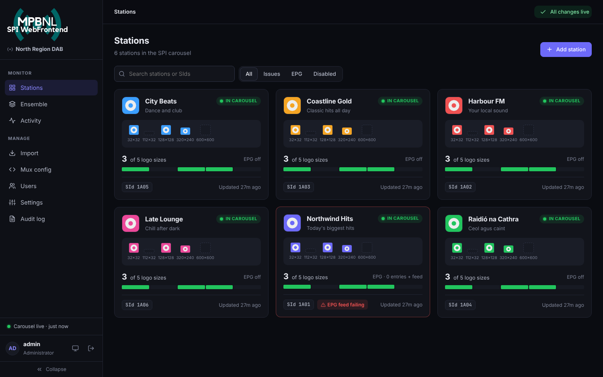

# MPBNL SPI WebFrontend

*Formerly ODR SPI Generator. It still installs as the `odr-spi-generator` service and command.*

A self-hosted **DAB+ SPI (Service & Programme Information)** generator for [OpenDigitalRadio](https://github.com/Opendigitalradio/) multiplexes, with a web UI.

It runs as a **systemd service**, builds the SPI carousel (station logos, names, descriptions, genres and **EPG**) as the packet-mode `.dat` file that ODR-DabMux reads, and keeps it up to date on its own.



- **Web UI**: manage stations, logos, EPG, the ensemble, users and settings from a browser.
- **Multi-user, with per-station access.** Station owners can update their own logos, descriptions and schedules without touching anyone else's.
- **Logos by upload or URL.** URL logos are re-fetched every night at midnight (configurable) and on every *Apply*. If a URL can't be reached, the last good image is kept.
- **EPG**: a weekly schedule editor plus optional XMLTV, SPI-XML or MPBNL feed import, broadcast as binary Programme Information for up to 14 days ahead.
- **Imports**: legacy SPI/XSI `serviceInformation` XML (logos included, with mis-encoded text like `Raidió` repaired automatically) and your existing `odr-dabmux` config.
- **Mux config helper**: the generator gives you ready-made `services` / `subchannels` / `components` entries for odr-dabmux.
- **One-click updates** from *Settings → Updates*.
- **Light and dark themes**, and your multiplex name on the login screen, sidebar and browser tab, so you can see at a glance which mux you're editing.
- **No fragile dependencies.** The encoder (MOT directory mode, MSC datagroups, packet mode, ETSI TS 102 371 binary SI/PI) is pure Python. You no longer need the git-installed `python-dabmot`, `python-dabmsc`, `hybridspi` or `odr-radiodns-bridge` packages.

Compliant with **ETSI TS 102 371** and **ETSI TS 102 818**. The service-information encoding is byte-identical to the original script, which was tested with [AbracaDABra](https://github.com/KejPi/AbracaDABra).

---

## Install

Tested target: **Debian 12 / Ubuntu 22.04+ / Raspberry Pi OS (bookworm)** with systemd and Python ≥ 3.9.

```bash
git clone https://github.com/ryanginn/ODR-SPI-Generator.git
cd ODR-SPI-Generator
sudo ./install.sh
```

The installer asks for:

| Question | Default | Notes |
| :-- | :-- | :-- |
| Web UI port | `8090` | |
| Listen address | `0.0.0.0` | Use `127.0.0.1` if you put it behind a reverse proxy |
| Run as user | `odr` if it exists, else a new `odr-spi` system user | This user must be able to **write the folder you pick for the SPI output** and should be able to read the logo folders you import from |

Non-interactive: `sudo ./install.sh --yes --port 8090 --bind 0.0.0.0 --user odr`.

When it finishes it prints the address to open, including a one-time **setup token**:

```
Installation complete.

  Open the web UI:
    http://192.168.1.20:8090/?token=Xr0…

  First-run setup token: Xr0…
```

### First-run setup

1. **Create the administrator.** The token is pre-filled from the link. You can show it again with `sudo odr-spi-generator setup-token`.
2. **Ensemble**: ECC, EId and labels. You can read them straight from your odr-dabmux config with the server file browser.
3. **Output & carousel**: pick where the `.dat` file is written (the file browser shows the server's folders and whether the service can write there), the SPI subchannel bitrate and the packet address.
4. **Mux config**: copy the example entries into your odr-dabmux config.
5. **Add stations**: import a legacy SPI XML, import your mux services, or add stations by hand. Then click **Apply**.

### Upgrade / uninstall

When installed from a git checkout, admins can update from **Settings → Updates**. *Check for updates* compares the installed commit with the branch you installed from, and *Update now* downloads and installs it. Configuration, data and the SPI output file are kept, and the page reconnects after the service restarts. The same works from a shell:

```bash
sudo odr-spi-generator-update check  # or: apply
git pull && sudo ./install.sh        # manual upgrade, keeps config + data
sudo ./uninstall.sh                  # removes the service, keeps /etc and /var/lib data
sudo ./uninstall.sh --purge          # removes everything (not your .dat file)
```

---

## Using it

### Apply

Edits are saved immediately but **published only when someone clicks *Apply***. The top bar shows when there are unpublished changes. *Apply* fetches every logo URL and EPG feed, snapshots the current state, builds the carousel and writes the output file.

The scheduled refresh (default: daily at 00:00, or every N hours) re-fetches URLs and feeds and rebuilds from the **last applied** state, so half-finished edits are never published by the timer. The scheduled rebuild also rolls the EPG window forward each day.

### Logos

Each station (and the ensemble) has one slot per size:

| Size | Use |
| :-- | :-- |
| 32 × 32 | Station list icon, shown by almost every receiver (the most important size) |
| 112 × 32 | Rectangle for car / hi-fi displays |
| 128 × 128 | Higher-resolution square |
| 320 × 240 | Widescreen, shown before slideshow loads |
| 600 × 600 | Large square for smart radios and apps |

For each slot you can **upload** a PNG/JPEG or **link a URL**. Images must be the exact size; if one isn't, the UI offers to scale it to fit (letterboxed). Every image is decoded and re-encoded before use, which strips metadata and anything that isn't image data. Imported legacy files with other sizes keep their own slots.

URL logos are fetched straight away, on every *Apply*, and on the refresh schedule. A failed fetch keeps the previous image and shows the error on the slot and in the Activity log.

### EPG

Per station, under **EPG**:

- **Programmes**: recurring weekly shows (pick days, optional start/end dates) and one-off programmes, each with title, description and genres.
- **Feed (optional)**: hand-entered programmes take priority and feed programmes fill the gaps. Supported formats:
  - **XMLTV** URL, with the channel id to use.
  - **SPI / RadioDNS PI XML** URL.
  - **JSON APIs, through templates**. Pick a template, then paste the station's URL. See below.
- **Preview**: the next days as receivers will get them.

*Settings → EPG* sets how many days to broadcast (default 7, 0 disables) and the timezone. Each extra day adds data, and the Activity page shows the full carousel cycle time at your bitrate.

### EPG API templates

*EPG templates* (editors and admins) holds recipes for reading schedules from JSON APIs, so a new station API needs no code change. A template says:

- **How to request**: one request per weekday (`day=Monday` … `Sunday`), one per date (`day=2026-10-27`), or one request for the whole week. The day goes into a query parameter you name, or into a `{day}` placeholder in the URL. Day tokens are `{weekday}`, `{weekday_lower}`, `{weekday_short}`, `{weekday_num}`, `{date}` and `{yyyymmdd}`.
- **Where the shows are**: a dotted path to the list, e.g. `response.items`. It may use day tokens, e.g. `{weekday_lower}` for `{"monday": [...]}`.
- **Which fields to use**: title, description, start, end or duration, and an optional weekday filter. `a|b` tries `a` then `b`.
- **How times are written**: clock times on that day (`24:00` = midnight, and shows past midnight are handled), local date-times, ISO 8601 or Unix timestamps.

**Test** fetches a URL and shows exactly what will be broadcast, before you save. **Copy JSON** and **Import JSON** let you share templates between installations. Three samples are included: **MPBNL**, **Coast FM** and **Radio Slovenija (RTV SLO)**. *Restore samples* brings back any you deleted. Templates are pure data and are never run as code. Every request goes through the same SSRF-protected fetcher as logo URLs.

### Importing legacy SPI / XSI XML

*Import → Legacy SPI / XSI XML* reads `serviceInformation` documents (SPI 3.x `<services>` as well as older `<ensemble>` layouts):

- names, short descriptions, genres (invalid ones such as `ContentCS:2002:10` are reported and skipped), website links
- all `dab:` bearers, including secondary components (e.g. `dab:2e3.2ea1.2491.1`)
- the ensemble id from `<services id="e32ea1">`
- **logos**: logos with `http(s)` URLs become URL logos. For local file names like `radio1_32x32.png`, point the import at the folder that holds them, either by **uploading the folder from your computer** or by **choosing a folder on the server** (admins). Matching files are copied into the generator's storage.
- text mangled by a wrong encoding (`Raidió Rí Rá`) is repaired (`Raidió Rí Rá`) and listed for review.

Merge mode updates stations that share the same primary SId and adds the rest. You can also add everything as new, or replace all stations.

### Warnings

The Activity page lists each build's warnings, such as a logo URL that can't be reached or a carousel that takes over 5 minutes to cycle. **Dismiss** hides a known warning on later builds too, so the status goes back to green. A dismissed slow-carousel warning comes back if the cycle grows more than 25% beyond what you dismissed. *Show them again* restores all dismissed warnings.

### Users and roles

| Role | Can do |
| :-- | :-- |
| **Administrator** | Everything: users, settings, server file browser, audit log |
| **Editor** | All stations, the ensemble, imports, mux config; can Apply |
| **Station owner** | Only their assigned stations: logos, descriptions, website, genres, EPG. Names, SIds and bearers stay with the operator. Can Apply only if the admin allows it |

New users get a temporary password and must change it at first login. Every login and change is recorded in the **audit log**.

### ODR-DabMux configuration

*Mux config* produces the three blocks for your odr-dabmux file, using your bitrate, packet address and output path, for example:

```text
services {
    srv-spi {
        id 0xe32ea1f1
        label "SPI"
        shortlabel "SPI"
    }
}
subchannels {
    sub-spi {
        type packet
        bitrate 16
        id 20
        protection-profile EEP_A
        protection 3
        inputproto file
        inputuri "/home/odr/ODR-mmbTools/config/mot/spi-output.dat"
    }
}
components {
    comp-spi {
        type 60
        service srv-spi
        subchannel sub-spi
        user-applications {
            userapp "spi"
        }
        address 0x1
        datagroup true
    }
}
```

- The SPI service id is 32-bit: `ECC + EId + 2 hex digits`.
- `bitrate` must match *Settings → Carousel*. The packet size follows the bitrate automatically. It is the largest DAB packet that fits a whole number of times into each 24 ms frame, as Opendigitalradio recommends. Too large and the SPI isn't transmitted; too small and it is slower than necessary.

  | Bitrate (kbps) | 8 | 16 | 24 | 32 | 40 | 48 | 56 | 64 | 72 | 80 | 88 | 96 |
  | :-- | --: | --: | --: | --: | --: | --: | --: | --: | --: | --: | --: | --: |
  | Packet size (bytes) | 24 | 48 | 72 | 96 | 24 | 72 | 24 | 96 | 72 | 48 | 24 | 96 |

  40, 56 and 88 kbps only fit 24-byte packets, so they spend more of the bitrate on packet headers. Prefer the other steps.
- **EEP_B** protection requires a bitrate that is a multiple of 32 kbps, so use **EEP_A** for 8–24 kbps. The page warns you about this.

By default the output file is **rewritten in place**, because ODR-DabMux keeps the file open and rewinds it at the end. *Settings → Output* can switch to atomic replace if your setup reopens the file.

---

## HTTPS

The UI uses plain HTTP unless you configure TLS. On anything but a trusted LAN, use one of these:

- **Built-in TLS.** Set `tls_cert` and `tls_key` (PEM paths readable by the service user) in `/etc/odr-spi-generator/config.json`, then `sudo systemctl restart odr-spi-generator`.
- **Reverse proxy** (recommended). Install with `--bind 127.0.0.1`, set `"behind_proxy": true` in the config, and proxy to it. nginx example:

  ```nginx
  location / {
      proxy_pass http://127.0.0.1:8090;
      proxy_set_header Host $host;
      proxy_set_header X-Forwarded-For $remote_addr;
      proxy_set_header X-Forwarded-Proto $scheme;
      proxy_set_header X-Forwarded-Host $host;
      client_max_body_size 40m;
  }
  ```

## Command line

```
sudo odr-spi-generator setup-token          # show the first-run setup token
sudo odr-spi-generator reset-password NAME  # temporary password for a user (also unlocks/enables)
sudo odr-spi-generator build                # refresh URLs and rebuild from the last applied state
systemctl status odr-spi-generator
journalctl -u odr-spi-generator -f
```

## Files

| Path | Contents |
| :-- | :-- |
| `/opt/odr-spi-generator` | Application and its Python virtualenv |
| `/etc/odr-spi-generator/config.json` | Port, listen address, TLS, data directory |
| `/var/lib/odr-spi-generator` | SQLite database, stored logos, EPG feed cache |
| `/etc/odr-spi-generator/update.conf` | Git source (URL and branch) for one-click updates, recorded by the installer |
| `/opt/odr-spi-generator/repo`, `/var/lib/odr-spi-generator-update` | Updater checkout, status and log |
| *(your choice)* | The SPI output `.dat` file |

## Security

See [SECURITY.md](SECURITY.md) for the security model and the audit that was done on this release.

## Development

```bash
python3 -m venv .venv && .venv/bin/pip install -e .
ODR_SPI_DATA_DIR=./data ODR_SPI_PORT=8090 .venv/bin/odr-spi-generator serve
.venv/bin/python -m unittest discover -s tests -t .
```

`tests/test_encoder_compat.py` can also check the encoder byte-for-byte against the original python-dabmot / python-dabmsc stack when those libraries are on `PYTHONPATH`.

The original single-file script is kept in [`legacy/ODR-SPI-Generator.py`](legacy/ODR-SPI-Generator.py) for reference.

---

### Credits

The full list is also under *Settings → Credits*.

- **Lucas Gallone**: the original [ODR-SPI-Generator](https://github.com/LucasGallone/ODR-SPI-Generator)
- **Nick Piggott**: [odr-radiodns-bridge](https://github.com/nickpiggott/odr-radiodns-bridge)
- **Opendigitalradio**: [ODR-mmbTools, python-dabmot, python-dabmsc](https://github.com/Opendigitalradio)
- **Ben Poor (magicbadger)**: [python-hybridspi](https://github.com/magicbadger/python-hybridspi)
- **Global Radio**: [python-mot-epg](https://github.com/GlobalRadio/python-mot-epg)
- **KejPi**: [AbracaDABra](https://github.com/KejPi/AbracaDABra), used to verify decoding
- **Rían Mac Fhionnghaile**: MPBNL SPI WebFrontend (web UI, EPG, multi-user service)

### License

GNU General Public License v3.0 (GPLv3). See [LICENSE](LICENSE).

Originally created by Lucas Gallone as an offline modification of ["odr-radiodns-bridge"](https://github.com/nickpiggott/odr-radiodns-bridge) by Nick Piggott (LGPL 2.1), building on the work of [OpenDigitalRadio](https://github.com/Opendigitalradio/).
